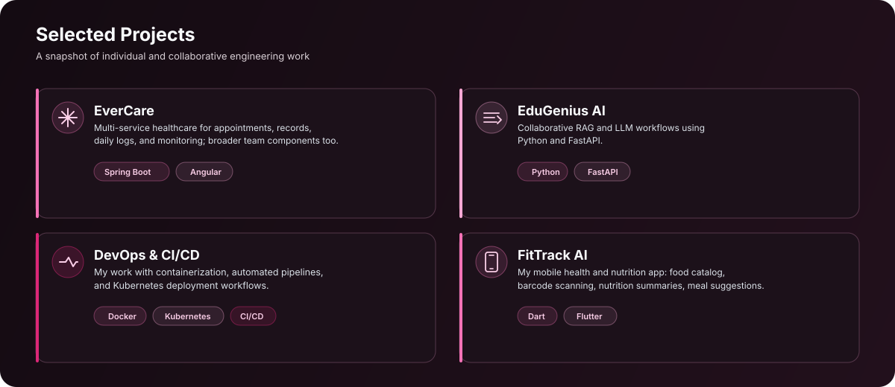



  

  <a href="https://www.linkedin.com/in/eyadabbaghi">LinkedIn</a> &nbsp;·&nbsp;
  <a href="mailto:eyadabbaghi2601@gmail.com">Email</a> &nbsp;·&nbsp; Tunis, Tunisia

  <a href="#about">About</a> &nbsp;·&nbsp;
  <a href="#featured-projects">Projects</a> &nbsp;·&nbsp;
  <a href="#tech-stack">Tech Stack</a>

## About

I'm a final-year Software Engineering student at ESPRIT in Tunis, seeking a **6-month PFE internship starting in early 2027**. My focus spans full-stack development with Java, Spring Boot, Angular, and FastAPI; AI and RAG workflows with LLMs; and DevOps practices using Docker, Kubernetes, and CI/CD. I also build mobile applications with Dart and Flutter.

## Featured Projects

  

### EverCare — Integrated Healthcare Platform

A microservices healthcare platform built with Spring Boot and Angular, covering appointments, medical records, activity and daily logs, and monitoring.

**Repositories:** [Esprit-PI-4SAE2-2025-EverCare](REPLACE_WITH_REPOSITORY_URL) · [EverCare-microservice](REPLACE_WITH_REPOSITORY_URL)

### AI / RAG & LLM Work

Retrieval-augmented generation and LLM-assisted workflows built with Python and FastAPI.

**Repository:** [AI / RAG project](REPLACE_WITH_REPOSITORY_URL)

### DevOps & CI/CD

Containerization, automated CI/CD pipelines, and Kubernetes deployment workflows.

**Repositories:** [devops-capstone-project](REPLACE_WITH_REPOSITORY_URL) · [ci-cd-final-project](REPLACE_WITH_REPOSITORY_URL)

### FitTrack AI — Mobile Development

A Dart and Flutter mobile health and nutrition app with a food catalog, barcode scanning, nutrition summaries, and meal recommendations.

**Repository:** [dev-mobile-project-2026](https://github.com/eyadabbaghi/dev-mobile-project-2026)

## Tech Stack

**Full-Stack & Backend**  
Java · Spring Boot · Angular · FastAPI · REST APIs · Microservices

**AI & RAG**  
Python · LLM pipelines · Retrieval-augmented generation

**DevOps & Mobile**  
Docker · Kubernetes · CI/CD · Dart · Flutter
