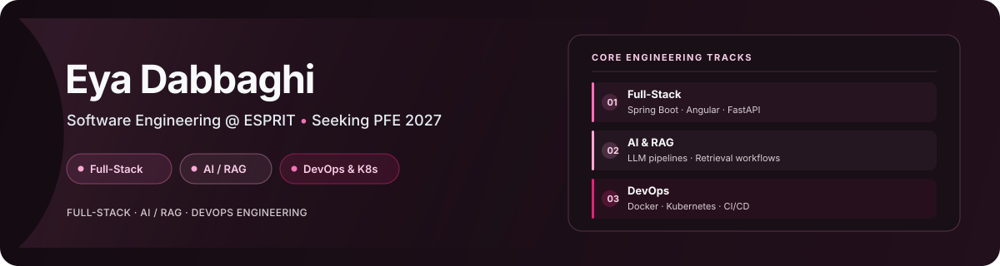



  

  <a href="https://www.linkedin.com/in/eyadabbaghi">LinkedIn</a>
  &nbsp;·&nbsp;
  <a href="mailto:eyadabbaghi2601@gmail.com">Email</a>
  &nbsp;·&nbsp;
  Tunis, Tunisia

## About

I'm a final-year Software Engineering student at ESPRIT in Tunis, seeking a **6-month PFE internship starting in early 2027**. I build full-stack applications with Java, Spring Boot, Angular, and FastAPI, and explore AI through retrieval-augmented generation and LLM workflows. I'm also interested in containerized delivery and deployment using Docker, Kubernetes, and CI/CD.

## Featured Projects

### EverCare — Integrated Healthcare Platform

A healthcare platform built with a microservices architecture using Spring Boot and Angular. It supports appointments, medical records, activity and daily logs, and monitoring.

**Repositories:** [Esprit-PI-4SAE2-2025-EverCare](repo link) · [EverCare-microservice](repo link)

### AI / RAG & LLM Work

Retrieval-augmented generation and LLM-assisted workflows built with Python and FastAPI.

**Repository:** [Add repository link](repo link)

### DevOps & CI/CD

Projects covering containerization, automated CI/CD pipelines, and Kubernetes deployment workflows.

**Repositories:** [devops-capstone-project](repo link) · [ci-cd-final-project](repo link)

### Mobile Development — FitTrack AI

A Dart and Flutter mobile application with meal and nutrition workflows alongside health tracking.

**Repositories:** [FitTrack AI](repo link) · [dev-mobile-project-2026](repo link)

## Tech Stack

| Domain | Technologies |
|---|---|
| **Full-Stack & Backend** | Java, Spring Boot, Angular, FastAPI, REST APIs, microservices |
| **AI & RAG** | Python, LLM-assisted workflows, retrieval-augmented generation |
| **DevOps** | Docker, Kubernetes, CI/CD |
| **Mobile** | Dart, Flutter |
